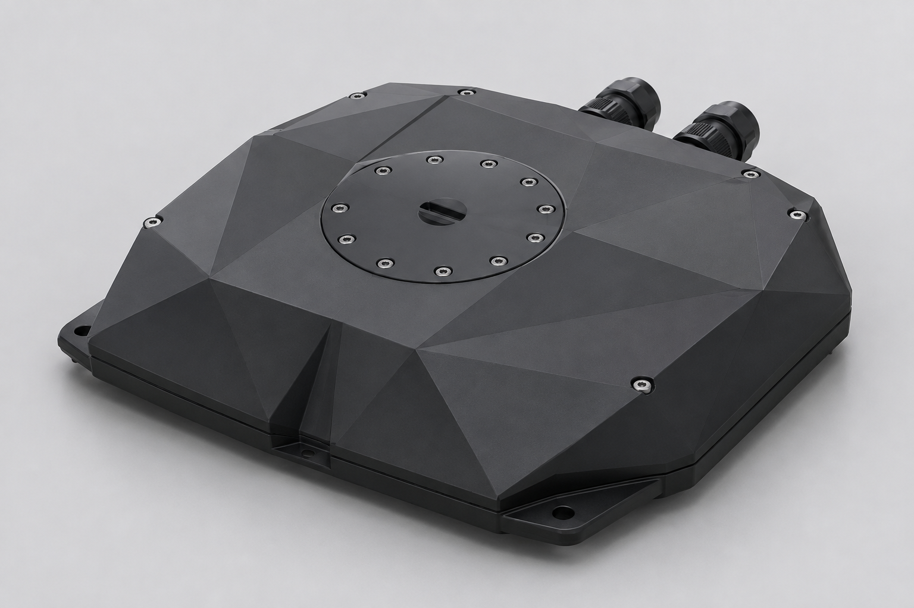
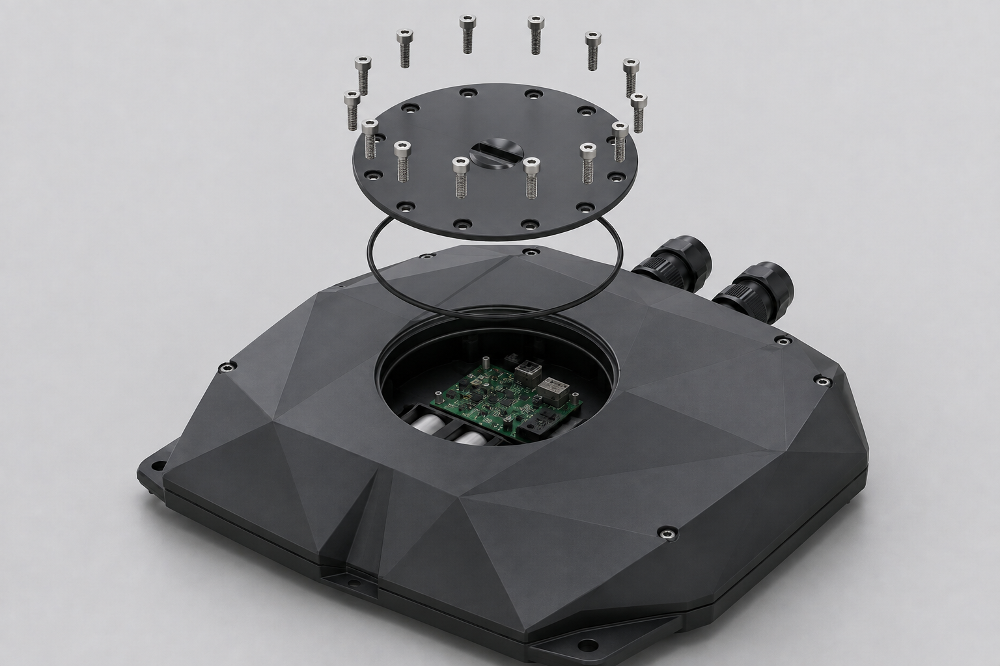

# Enclosure CAD and release status

| File | Geometry and purpose | Status |
|---|---|---|
| [hyper-grey-v1.stl](hyper-grey-v1.stl) | Supplied DAA mesh; 168 × 210 × 40 mm, 3,934 facets | Form/envelope reference; mesh inspection found 49 edges with incidence other than two |
| [seanergy-enclosure-v2.scad](seanergy-enclosure-v2.scad) | Parametric maximum envelope, access cap, O-ring and fastener pattern | Proposed sealed design requiring solid/mechanical review |

V1 is not treated as a closed pressure solid. No verified STEP export is supplied. A native solid CAD review and verified fabrication export are required before a mechanical release.

See the [enclosure guide](../README.md) for fit, print and sealing documents. The [dunk/pressure test](../dunk-test.md) is an unperformed acceptance plan; renders and printed form alone do not establish a depth rating.
