<p align="center">
  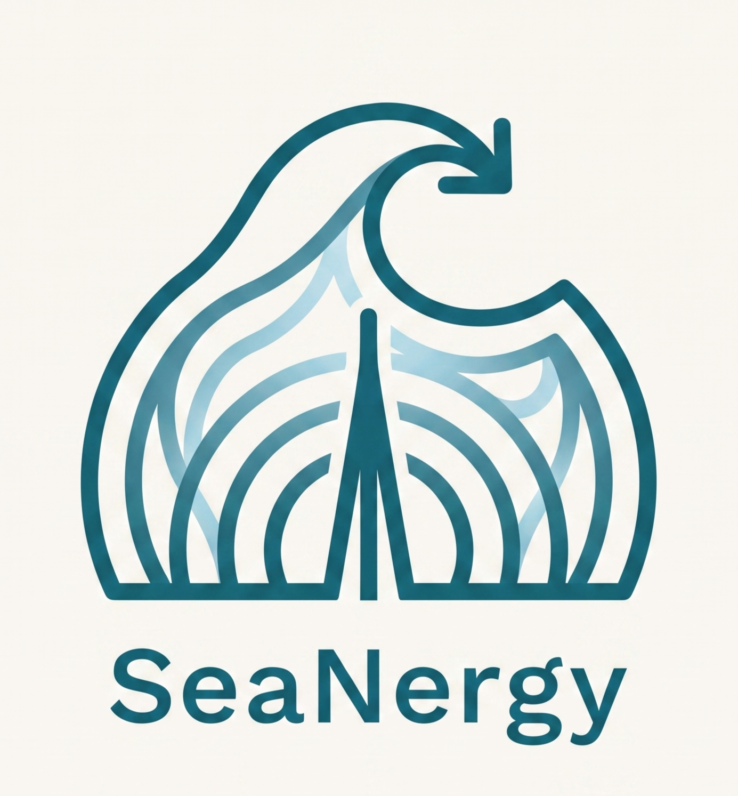
</p>

<h1 align="center">SeaNergy · HyperGrey</h1>
<p align="center"><strong>Sonar that reads the water before it sends the ping.</strong></p>
<p align="center">A low-power, adaptive software-defined sonar transmitter payload for autonomous underwater vehicles.</p>

<p align="center">
  
  
  
  
</p>
<p align="center">
  
  
  
  
  
  
</p>

<p align="center">
  <a href="https://www.hypergrey.in/">Project website</a> ·
  <a href="https://www.youtube.com/playlist?list=PLfZXQHCNRlPQ">Demo playlist</a> ·
  <a href="04-software/releases/SeaNergy-2.2.0___android.apk">Android APK</a> ·
  <a href="07-documentation/research-paper/SeaNergy_Adaptive_Sonar_Research_Paper.pdf">Research paper</a> ·
  <a href="https://www.kaggle.com/code/prakhar1803/adaptive-sonar-waveform-selection">Kaggle notebook</a>
</p>

[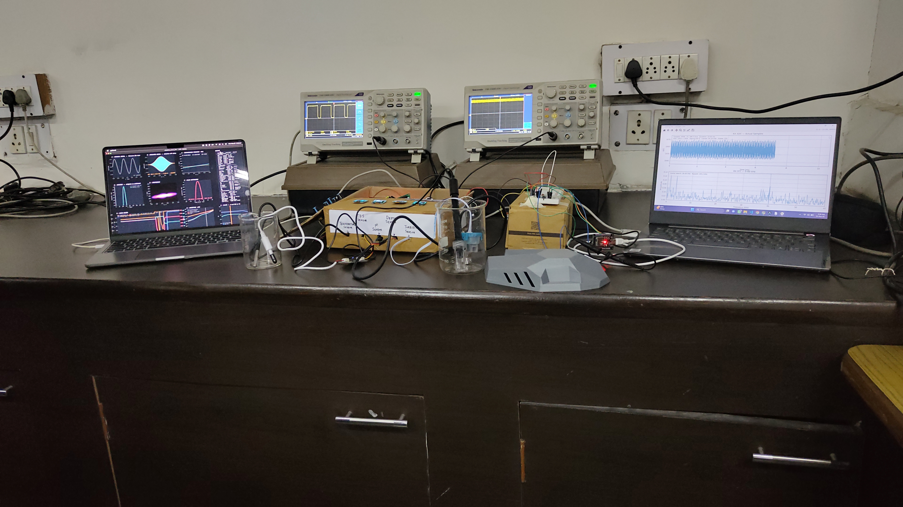](08-media/photos/IMG_20260921_093807880.jpg)

*The two-DSO bench setup: two digital oscilloscopes, waveform dashboards, controller electronics, probe vessels, and the printed payload housing. September 2026 prototype session.*

SeaNergy is **HyperGrey's Smart India Hackathon 2026** response to **SIH26058**, from the **Ministry of Earth Sciences / National Institute of Ocean Technology**. The problem asks for a low-power, real-time adaptive software-defined sonar transmitter payload for AUVs. Our work connects underwater acoustics, constrained waveform selection, embedded signal generation, analog electronics, mechanical fabrication, and an offline operator console.

The central question is practical: **what pulse should an AUV send next, given the water, the mission, and its energy budget?** SeaNergy makes that decision inspectable—from environmental inputs and propagation assumptions to frequency, bandwidth, pulse duration, waveform, and detection estimates.

## Prototype gallery

A closer look at the physical build, hands-on tuning, and instrumented bench work. Click any photograph to open the original.

| Controller and local displays | Hands-on bench tuning |
|:---:|:---:|
| [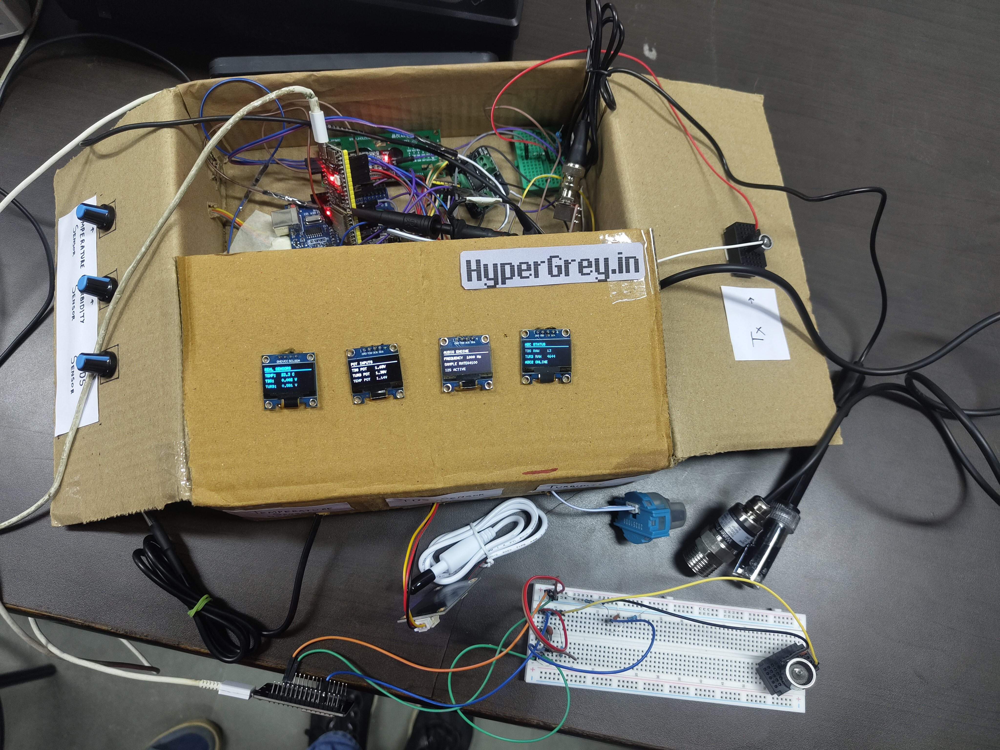](08-media/photos/IMG_20260915_121651963.jpg) | [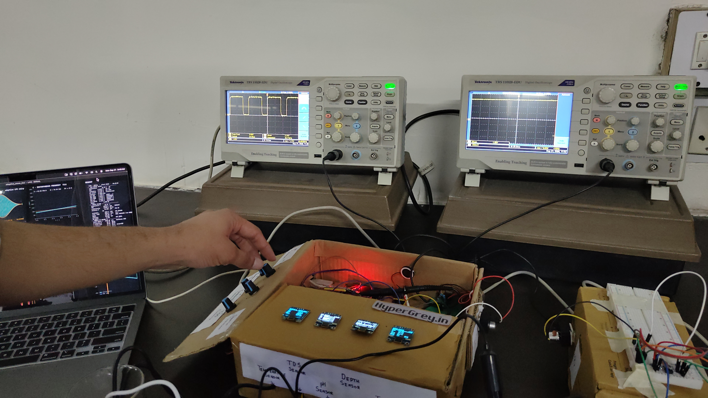](08-media/photos/IMG_20260921_094059848.jpg) |
| Four OLEDs, manual controls, sensor wiring, and the breadboard transducer stage. | Adjusting the prototype controls while observing the electrical signals. |

| Two-DSO waveform checks | Burst transmission on the bench |
|:---:|:---:|
| [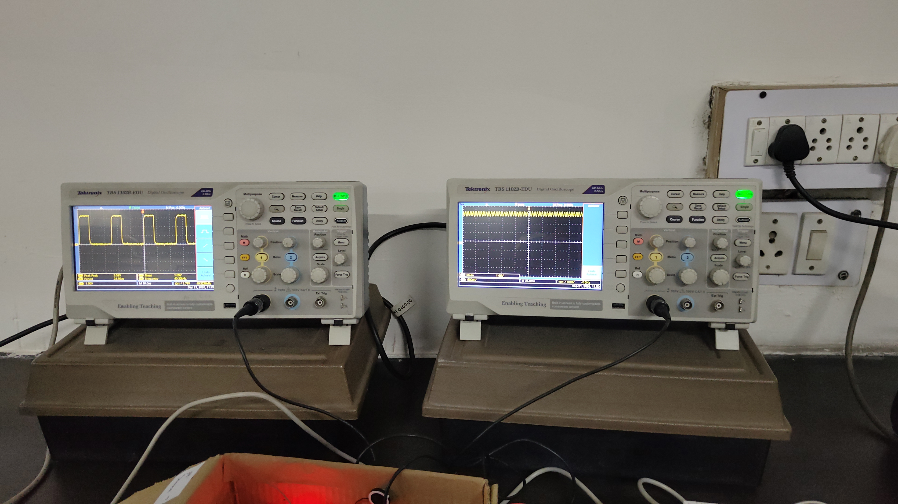](08-media/photos/IMG_20260921_094123797.jpg) | [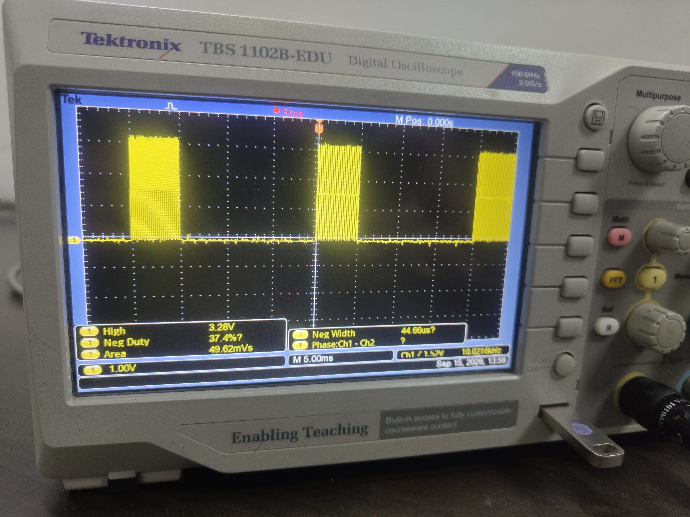](08-media/readme/SeaNergy-bench-bursts-photo.jpg) |
| Two oscilloscopes used side by side to inspect electrical waveforms. | Repeated carrier packets separated by quiet intervals. |

### App screens

| Console | Sonar view | Diagnostics |
|:---:|:---:|:---:|
| [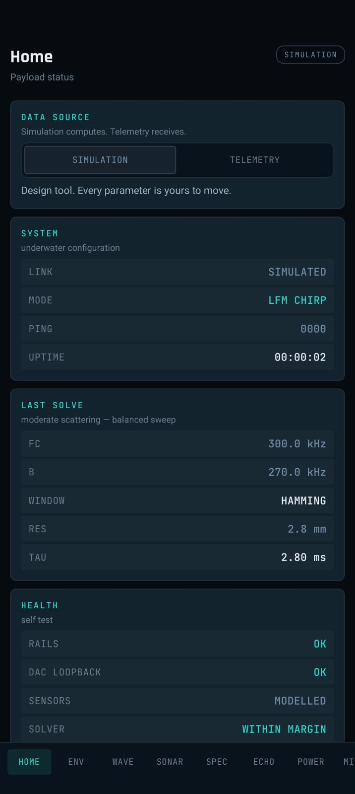](08-media/readme/SeaNergy-app-console-simulation.jpeg) | [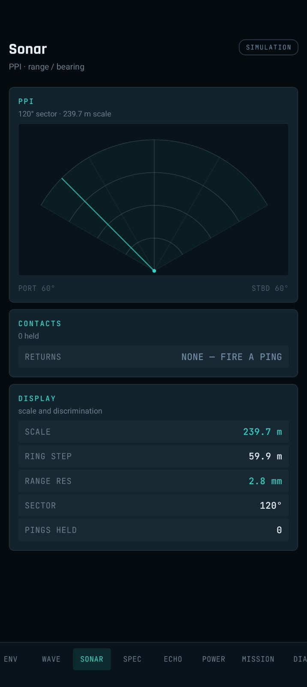](08-media/readme/SeaNergy-app-sonar-simulation.jpeg) | [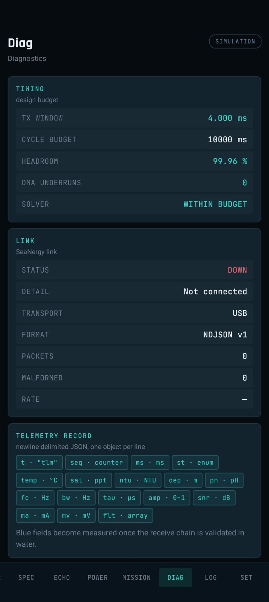](08-media/readme/SeaNergy-app-diagnostics-simulation.jpeg) |

*Simulation-mode app screenshots. More environment, waveform, and spectrum views appear in [Operator software](#operator-software). Click a screenshot for its full-resolution view.*

### Graphs dashboard

[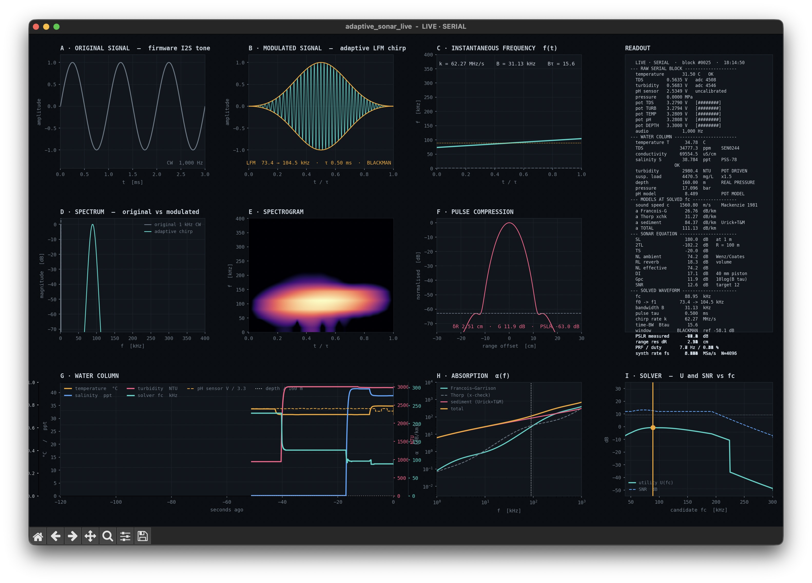](08-media/readme/SeaNergy-signal-analysis-dashboard.jpg)

*September 2026 development dashboard combining serial input readouts with computed waveform, spectral, pulse-compression, propagation, and solver plots. Click to inspect the full-resolution dashboard.*

## Start with the evidence

| Review route | What to open |
|---|---|
| **See the prototype** | [Hardware demo with DSO](https://www.youtube.com/watch?v=S5sL9P1SnnM), [changing water conditions](https://www.youtube.com/watch?v=R3WoJ25fv1Y), and [prototype photographs](08-media/photos/) |
| **Try the interface** | [Android v2.2.0 APK](04-software/releases/SeaNergy-2.2.0___android.apk), [app demo](https://www.youtube.com/watch?v=PedR7m0j_bs), and [software guide](04-software/README.md) |
| **Inspect the engineering** | [Hardware design](01-hardware/README.md), [board verification](01-hardware/verification-summary.md), and [current TX/RX firmware](02-firmware/README.md) |
| **Check the reasoning** | [21-page project research paper](07-documentation/research-paper/SeaNergy_Adaptive_Sonar_Research_Paper.pdf), [literature library](03-research/README.md), and [reproducible modelling package](05-models/) |
| **Review the submission** | [Compliance material](00-submission/compliance-matrix/) and [demo procedure](00-submission/demo-script/demo-script.md) |

**Contents:** [Photo gallery](#prototype-gallery) · [App screens](#app-screens) · [Graphs dashboard](#graphs-dashboard) · [Problem and approach](#problem-and-approach) · [Architecture](#architecture) · [Prototype and hardware](#prototype-and-hardware) · [Firmware](#firmware) · [Research and results](#research-and-results) · [Operator software](#operator-software) · [Verification](#verification-and-readiness) · [Reproduce](#reproduce-the-work) · [Roadmap](#next-engineering-milestones) · [Team](#team-and-ownership)

## Problem and approach

An AUV carries a finite energy store into water whose acoustic properties change. Higher frequencies can provide finer detail, but propagation loss rises with frequency. A longer pulse carries more energy, but an unmodulated pulse also broadens the return in time. Turbidity introduces further loss and uncertainty; temperature, salinity, depth, and pH affect the propagation model. A fixed waveform therefore commits to one compromise across changing conditions.

SeaNergy explores a transmitter that can adjust that compromise deliberately:

1. **Read the environment.** Use measured inputs where calibrated sensing is available, or explicit simulation inputs during model development.
2. **Estimate propagation.** Calculate sound speed, absorption, scattering loss, and the active-sonar link budget under stated assumptions.
3. **Choose a feasible pulse.** Search a bounded candidate set for useful bandwidth while respecting detection margin and energy constraints.
4. **Generate the waveform.** Prepare a digital pulse, apply its envelope, and let the output peripheral clock the samples.
5. **Inspect the result.** Expose waveform, spectrum, diagnostics, and decision inputs to the operator. The software model also studies echo correlation and feedback.

The intended applications include AUV inspection, survey, and obstacle sensing. SeaNergy is currently a **bench prototype and engineering development platform**; deployment performance will depend on the completed acoustic chain and measured underwater validation.

## Architecture

The repository contains three connected lines of work. This diagram shows their current boundaries so that a reviewer can follow each implementation directly.

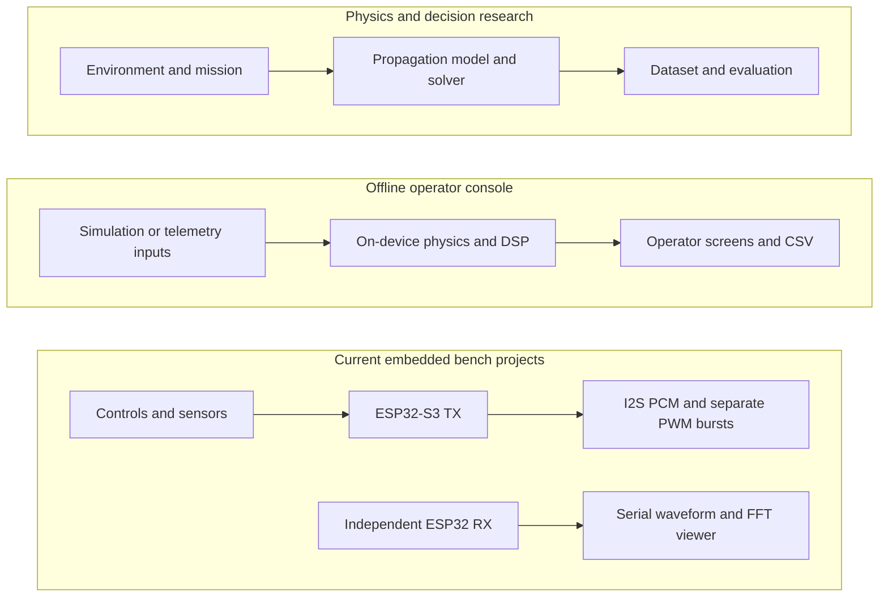

| Workstream | Present implementation | Evidence boundary |
|---|---|---|
| **Physical prototype** | Sensor/control electronics, displays, nominal 40 kHz electrical carrier and burst captures, printed payload housing | Supplied photographs and demonstrations; these do not establish acoustic range or a rated underwater enclosure |
| **PCB revision** | AUV V3 Compact Rev B, 100 × 100 mm, two copper layers, 91 footprints | KiCad checks and manufacturing package; this revision has not been fabricated |
| **Embedded software** | Separate TX synthesis/DMA and RX capture/viewer projects | Host tests and recorded cross-builds; the replacement firmware still needs physical validation |
| **Decision research** | Reproducible 100–500 kHz numerical study with 20,000 generated rows | Model outputs under declared assumptions, separate from the 40 kHz bench hardware |
| **Operator console** | Offline simulation and telemetry adapters; Android release and iOS source | Simulation works independently; the current firmware does not yet implement the app protocol |

## Prototype and hardware

### From bench assembly to a payload form

| Bench integration | Printed payload housing |
|:---:|:---:|
| 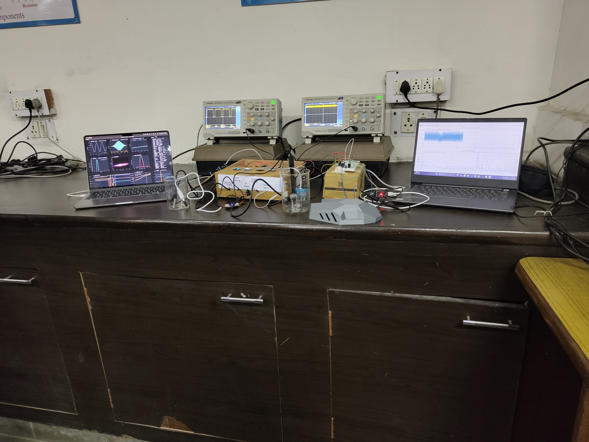 | 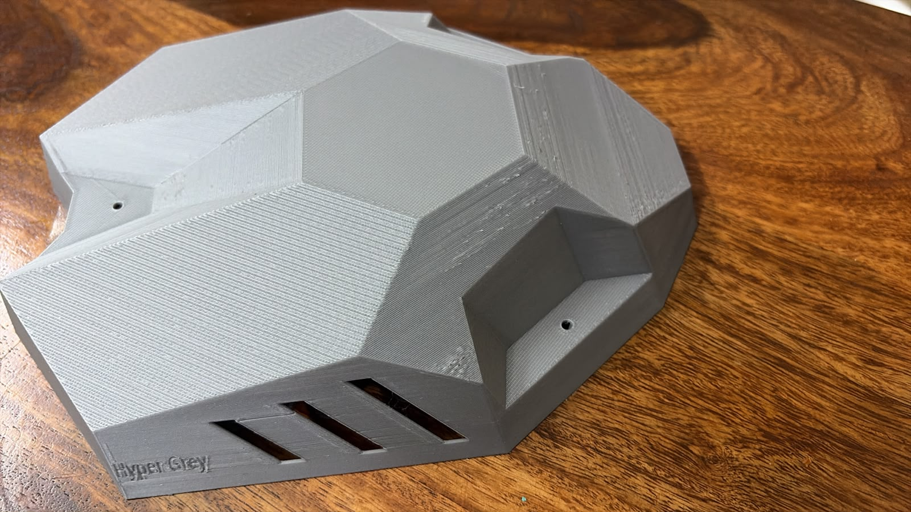 |
| Prototype electronics, sensor vessels, instrument checks, and operator software in one development setup. | Fabricated housing showing the intended payload form and electronics packaging work. |

| Early prototype integration | Housing fabrication |
|:---:|:---:|
| [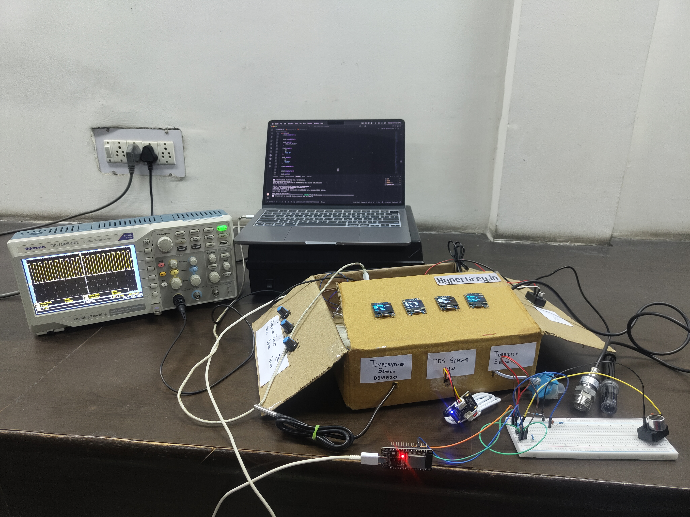](08-media/photos/IMG_20260915_121550453.jpg) | [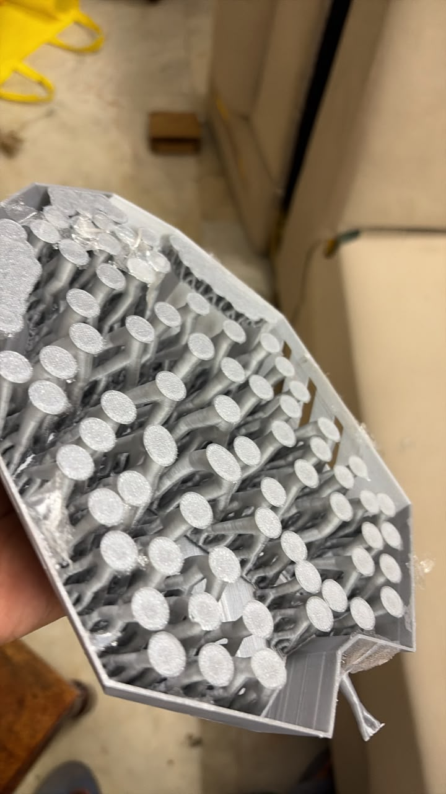](08-media/readme/SeaNergy-payload-fabrication.jpeg) |
| Sensor connections, local displays, controller electronics, and the breadboard stage during early integration. | The physical printed part and support structure during fabrication. |


The bench assembly made the project tangible: real controllers, analog interfaces, sensor inputs, OLED readouts, transmit/receive elements, and instrumented output. Mechanical work progressed through CAD and 3D printing to physical parts. The [fabrication photo](08-media/readme/SeaNergy-payload-fabrication.jpeg), [fabrication time-lapse](https://www.youtube.com/watch?v=OgWcE8eJ3iM), [STL](01-hardware/enclosure/cad/hyper-grey-v1.stl), and [enclosure documentation](01-hardware/enclosure/) preserve that process. Printed fit and form do not by themselves establish pressure resistance or sealing.

### Electrical observations

| Nominal 40 kHz carrier | Gated carrier packets |
|:---:|:---:|
| 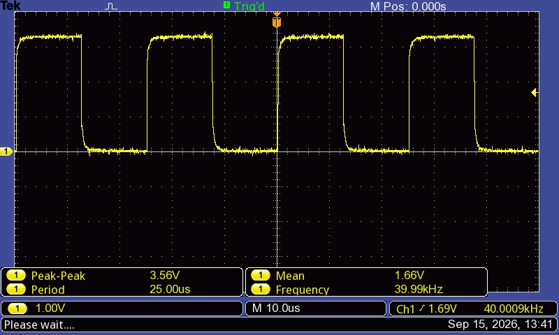 | 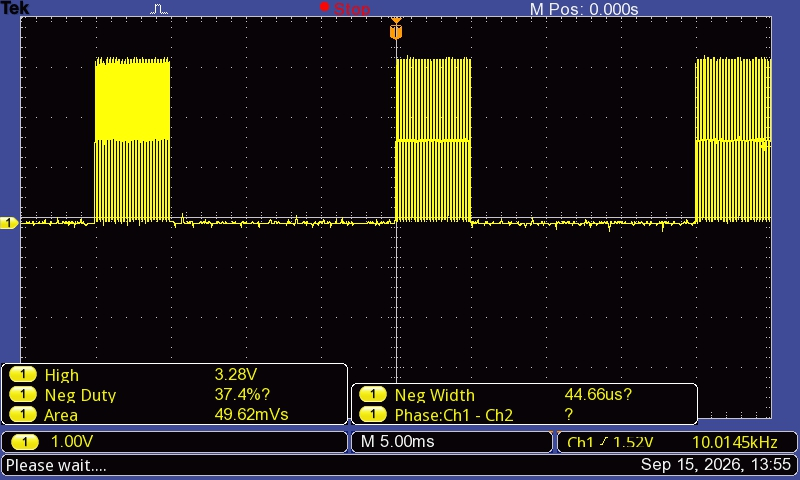 |
| Instrument display: **39.99 kHz**, **25.00 μs**, **3.56 V peak-to-peak**. | Carrier cycles grouped into bursts with gaps between transmissions. |

These supplied September 2026 captures document electrical carrier and burst behaviour in the earlier prototype. Their test point, probe configuration, and calibration record are not attached. They support the bench demonstration; measurements of chirp fidelity, spectral sidelobes, acoustic output, range, and battery power require their own recorded tests. Question-marked automatic measurements in the burst capture are not used as performance results.

<details>
<summary>Additional oscilloscope observations from the supplied bench session</summary>

| Periodic oscillation | Analog trace with switching transients |
|:---:|:---:|
| 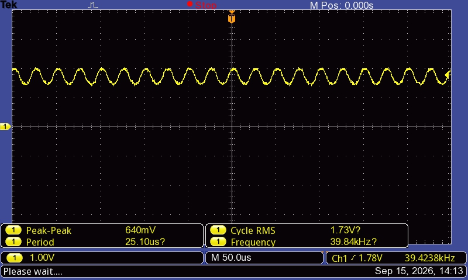 | 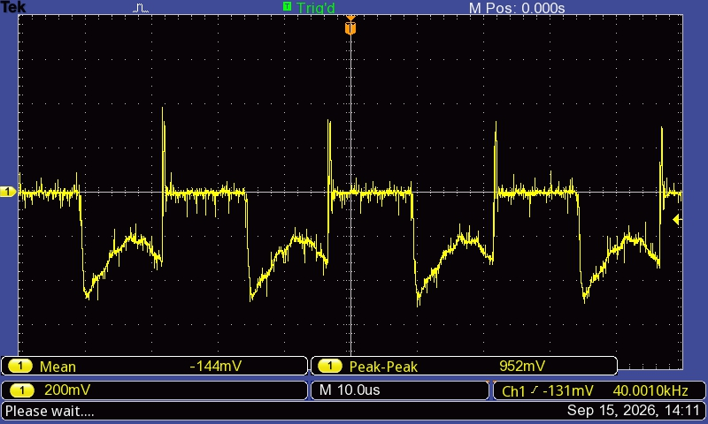 |

These captures preserve further signal observations from the September bench session. Signal nodes and coupling settings are not documented, so they are not assigned to a particular filter or receive stage. Question-marked automatic readings are not used as validation metrics.

</details>

### AUV V3 Compact Rev B PCB

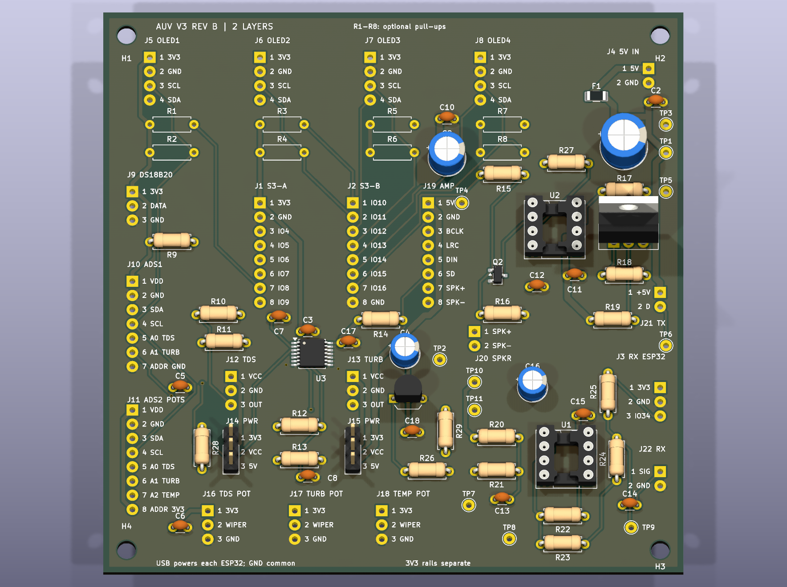

*PCB design render. The Rev B board is checked and packaged for manufacture; it is not the assembled board in the prototype photographs.*

The compact interconnect PCB provides wired connections for an **ESP32-S3 main/transmit controller** and a **separate ESP32 receiver**. Controllers and other external modules connect through labelled solder pads and require separate mounting; the 100 × 100 mm dimension describes the interconnect PCB. Its interfaces include two ADS1115 ADCs, DS18B20 temperature sensing, TDS and turbidity channels, four OLED displays, a MAX98357A audio path, and nominal 40 kHz transmit/receive connections. The receive section includes a biased analog gain stage. Main and receive electronics have separate 3.3 V rails with a common ground.

The design spans seven schematic sheets. The [saved verification report](01-hardware/kicad/verification/final-verification.json) records 91 footprints, 483 track segments, six vias, and two ground zones, with **zero ERC violations, zero DRC violations, zero unconnected items, and zero schematic/PCB parity issues**. These are design checks, not electrical qualification.

**Inspect or manufacture:** [schematic PDF](01-hardware/schematics/schematic.pdf) · [assembly PDF](01-hardware/kicad/previews/Assembly.pdf) · [Gerber ZIP](01-hardware/pcb/gerbers/AUV_V3_RevB_Compact_Gerbers.zip) · [BOM](01-hardware/bom/) · [release checksums](01-hardware/release-sha256.json) · [wiring and design notes](01-hardware/README.md).

## Firmware

The current firmware uses two independently buildable PlatformIO projects. The implementation separates waveform preparation from peripheral playback so the CPU does not have to write every sample at transmission time.

| Component | Implemented behaviour |
|---|---|
| **ESP32-S3 TX** | Fixed-point carrier phase accumulator and sine lookup table; cached pulse synthesis; complete stereo-buffer preload into I2S DMA; hardware-clocked playback |
| **Waveform modes** | Linear frequency modulation, geometric/logarithmic sweep, and Barker-13 BPSK; Barker uses a fixed midpoint carrier with 13 phase-coded chips |
| **PCM envelopes** | Hann, Blackman, and endpoint-tapered Hamming; mode/window selection and actual sample preview on the displays |
| **Burst scheduling** | GPTimer scheduling and separate GPIO16 PWM gating; no busy-wait sample loop |
| **Control and faults** | Disarmed boot, explicit ARM/STOP, stale-input detection, control heartbeat, playback deadline, missed-period and late-gate faults |
| **ESP32 RX** | GPIO34 ADC capture through I2S DMA, ASCII serial frames, and a Python live waveform/Hann-FFT viewer |

### Output profiles and hardware limits

- **Existing MAX98357A profile:** 48 ksample/s PCM playback with **1–8 kHz** waveform settings. A separate GPIO16 output provides **38–42 kHz rectangular PWM bursts**. The chirp arrays and PCM envelopes apply to I2S, not to that PWM output.
- **Optional PCM5102A profile:** 384 ksample/s PCM for a **38–42 kHz** bench configuration. This requires replacing the DAC hardware and adding a suitable analog frontend and power driver; its buffered filter design is documented for subsequent validation.
- **100–500 kHz study:** the research frequency band requires a different output chain. It is not an output capability of either current bench profile.

Five physical potentiometers presently drive bounded frequency, bandwidth, duration, and amplitude mappings. Real sensor voltages and temperature are reported separately. Calibrated sensor-to-physics adaptation is still an integration milestone. The current five-pot TX wiring also differs from the earlier three-pot Rev B companion design; [compatibility notes](02-firmware/README.md) explain the revisions.

TX and RX currently have **no shared trigger, implemented time-of-flight ranging, matched-filter receiver, or app telemetry protocol**. The RX sample-clock estimate and ADC word interpretation need measurement before range can be derived from samples. The [replaced ESP-IDF parallel-DAC implementation](02-firmware/legacy/esp-idf-payload/) remains available as historical work, with its own assumptions.

**Read the implementation:** [TX guide](02-firmware/tx/README.md) · [TX hardware profiles and bench procedure](02-firmware/tx/HARDWARE.md) · [RX project](02-firmware/rx/) · [architecture](02-firmware/docs/architecture.md).

## Research and results

### Literature that shaped the design

The [research library](03-research/README.md) contains **132 reference PDFs across 15 topic areas**, with topic indexes connecting papers to design decisions. It covers sound speed, absorption, sediment scattering, sonar detection, chirp design, matched filtering, windows and sidelobes, phase codes, cognitive sonar, DDS, transducers, AUV integration, embedded power, and machine learning.

The foundations include Mackenzie's sound-speed relation, Thorp and Francois–Garrison absorption models, active-sonar link budgets, Harris's window analysis, and Barker codes. The [21-page project manuscript](07-documentation/research-paper/SeaNergy_Adaptive_Sonar_Research_Paper.pdf), **“Physics-Constrained Adaptive Sonar Waveform Selection and Low-Power Transmit Architecture for Autonomous Underwater Vehicles,”** brings the modelling, architecture, experiments, and limitations together. It is a project research manuscript, with generated studies, team-reported observations, and engineering projections identified within it.

### The decision engine

Each solve evaluates **468 candidates: 13 centre frequencies × 6 bandwidth fractions × 6 pulse durations**. The solver checks the modelled detection margin and energy budget, prioritizes useful feasible bandwidth, and uses energy to distinguish equivalent choices. It includes explicit fallback behaviour when the requested margin cannot be achieved.

The main relationships make the trade-offs visible:

| Relationship | Design implication |
|---|---|
| Range resolution: **ΔR ≈ c / (2B)** | Wider effective bandwidth can separate closer reflectors after compression |
| Pulse-compression gain: **≈ 10 log₁₀(BT)** | A swept pulse can combine pulse energy with a narrower compressed response |
| Two-way propagation loss | A return must survive both outward and return travel; frequency and range matter together |
| Windowing | Lower sidelobes trade against main-lobe width and usable pulse energy |

These are model relationships, not a guarantee that a narrowband transducer or an uncalibrated analog chain will achieve the calculated resolution. The notebook uses **Mackenzie + Thorp + parameterized scattering**. The current app implements **Mackenzie + Francois–Garrison**, including depth and pH effects. The two implementations represent documented stages of the work and should be evaluated with their respective assumptions.

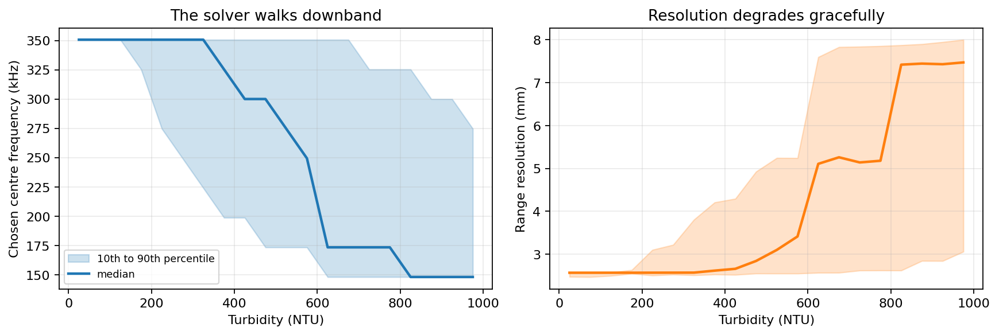

*Generated numerical study in the 100–500 kHz band. This illustrates the solver's trade-off under its loss model; the millimetre-scale values are calculated resolution, not measured tank resolution.*

### Reproducible dataset

The [dataset](05-models/dataset/adaptive_sonar_waveform_selection.csv) contains **20,000 generated rows and 27 columns**, with seed **20260829**. Its sampling deliberately combines broad coverage with difficult cases:

| Stratum | Rows | Purpose |
|---|---:|---|
| Sweep | 8,000 | Controlled exploration of environmental changes |
| Fill | 5,000 | Broader coverage between selected conditions |
| Scenario | 4,000 | Mission-style combinations of conditions |
| Adversarial | 3,000 | Stress cases outside the requested feasible operating margin |

Under the dataset's requested margin, **15,399 rows are feasible and 4,601 are not**. Keeping infeasible cases visible helps expose where the model must report a limitation instead of producing an apparently successful decision. This is a transmit-side modelling dataset, not collected sonar echoes or tank measurements.

### What the model comparison taught us

We trained three histogram gradient-boosting regressors to imitate the solver's centre frequency, bandwidth, and duration decisions. The routine split contains **12,750 training rows and 4,250 test rows**, with a separate **3,000-row stress set**. The stored [evaluation metrics](05-models/evaluation/metrics.json) report:

| Target | Constant mean baseline MAE | Surrogate MAE | Reduction |
|---|---:|---:|---:|
| Centre frequency | 69.57 kHz | 3.58 kHz | 94.8% |
| Bandwidth | 61.30 kHz | 4.00 kHz | 93.5% |
| Pulse duration | 2.404 ms | 1.666 ms | 30.7% |

Accuracy alone did not justify replacing the solver. A leakage audit removed chosen-frequency loss features that revealed the answer; the final comparison uses pre-decision environmental and reference-band features. On the recorded development-host benchmark, the precomputed solver's median was **40.3 μs**, while single-row Python surrogate inference took **7.45 ms**. These are host timings, not ESP32 timings. Constraint violations also remained in the surrogate evaluation.

The resulting engineering choice is to retain an explicit bounded solver as the decision reference. A separate **synthetic residual-correction study** asks whether learning propagation-model error is more useful than predicting the whole decision. Its gradient-boosting correction achieved **0.729 dB MAE**, compared with **1.005 dB** for a linear turbidity model and **1.963 dB** for a constant correction. This remains a modelling study requiring real measured residuals and independent calibration before deployment.

**Explore:** [notebook and figures](05-models/notebook/) · [evaluation methods and limitations](05-models/evaluation/) · [Kaggle version](https://www.kaggle.com/code/prakhar1803/adaptive-sonar-waveform-selection) · [dataset checks](05-models/qa.py).

## Operator software

The console turns the physics and signal-processing work into an interface that can be demonstrated without a network connection. It runs the numerical work on the device and labels **Simulation** and **Telemetry** modes explicitly.

| Environment | Waveform | Spectrum |
|:---:|:---:|:---:|
| 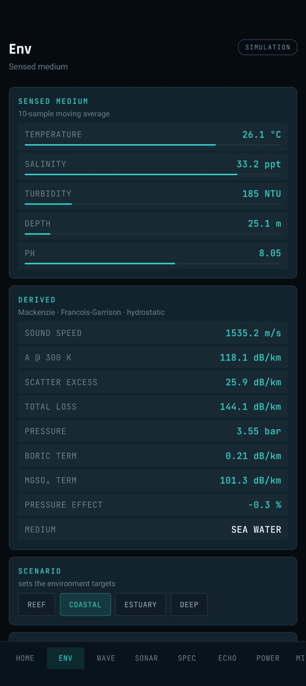 | 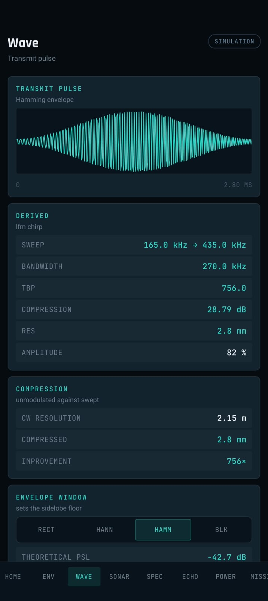 | 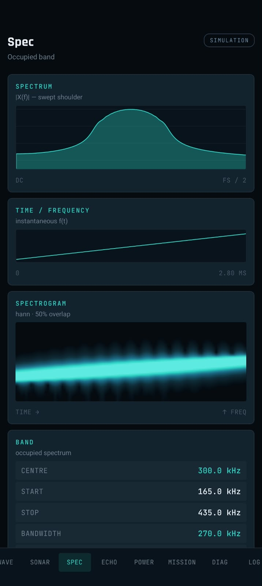 |

*App screenshots in simulation mode. Frequencies, compression, echo, resolution, and power values in this mode are numerical outputs.*

The current source provides **11 tabs plus a Scenario screen**, with individual ping detail. Together they cover the console, sonar PPI, waveform, spectrum, echo/correlation, environment, mission, power, diagnostics, logs, settings, and scenarios.

| Capability | Implementation |
|---|---|
| **Environmental reasoning** | Temperature, salinity, turbidity, depth, and pH inputs; sound-speed and absorption breakdown |
| **Waveform inspection** | CW, LFM, geometric sweeps, Barker-13; rectangular, Hann, Hamming, and Blackman windows |
| **Signal processing** | FFT, spectrogram, transmit replica, modelled echo, and matched-filter analysis in simulation |
| **Operator workflow** | Mission parameters, diagnostics, last 200 ping records in memory, and local CSV export |
| **Android links** | Native USB CDC-ACM/CP210x and BLE adapters; Wi-Fi WebSocket with HTTP fallback |
| **iOS work** | Shared application source and native project; Wi-Fi path available, native USB/BLE module and installable IPA outstanding |

The telemetry contract describes payload-reported environment and pulse settings. It does not carry raw RX waveform arrays, and the current TX/RX firmware does not yet emit that contract. The app's end-to-end simulated echo and feedback loop therefore remains distinct from an integrated physical receive loop.

**Stack:** React Native **0.86.2**, Expo **57**, React **19**, TypeScript, Skia charts, and a Kotlin Android connection module. The [static project website](04-software/website/) uses HTML, CSS, and JavaScript and can run locally without a backend.

**Install or inspect:** [universal Android APK](04-software/releases/SeaNergy-2.2.0___android.apk) · [smaller architecture-specific APKs](04-software/releases/) · [release record](04-software/releases/BUILDS.md) · [Android source](04-software/mobile-android/) · [iOS source](04-software/mobile-ios/) · [software guide](04-software/README.md).

## Demonstration library

The [Hyper Grey SIH 2026 (SeaNergy) playlist](https://www.youtube.com/playlist?list=PLfZXQHCNRlPQ) contains six videos, verified on **16 October 2026**:

| Video | Duration |
|---|---:|
| [1.1 Hardware Demo (with DSO)](https://www.youtube.com/watch?v=S5sL9P1SnnM) | 1:17 |
| [1.2 Hardware Demo ( Changing Water Conditions )](https://www.youtube.com/watch?v=R3WoJ25fv1Y) | 1:54 |
| [2.1 android app demo](https://www.youtube.com/watch?v=PedR7m0j_bs) | 4:43 |
| [3.1 Hardware parts description](https://www.youtube.com/watch?v=1TF7gd7LjTs) | 3:51 |
| [3.2 Hardware Graphs: Overview and Approach](https://www.youtube.com/watch?v=NZ1CEJT-cyo) | 3:23 |
| [Custom Payload Fabrication Time-Lapse](https://www.youtube.com/watch?v=OgWcE8eJ3iM) | 0:09 |

Additional material: [Google Drive photo collection](https://drive.google.com/drive/folders/15Eb-qjRcj5WRZOpzTAzsjD7BbMPWwIrb?usp=sharing) · [repository photo archive](08-media/photos/) · [media provenance and captions](08-media/readme/README.md).

## Verification and readiness

The project keeps the evidence type beside the result. This makes the substantial completed work reviewable while keeping the remaining integration tests concrete.

| Evidence | Recorded result | What it establishes |
|---|---|---|
| **Bench photographs and scope captures** | Physical assembly, displayed nominal 40 kHz carrier, and burst packets | Earlier prototype construction and electrical observations |
| **Rev B KiCad checks** | ERC/DRC/unconnected/parity all zero | Design consistency and routing checks for the saved board revision |
| **Current TX host waveform tests** | **409,765 checks passed**, strict C++17 build with undefined-behaviour sanitizer; rerun during this README review | Analytic waveform agreement, window/mode combinations, bounds, endpoints, amplitude and stereo behaviour |
| **Current TX cross-build record** | Existing, headless, and PCM5102A profiles passed on 16 October 2026 | Source compiles for the pinned framework; no upload or physical timing/power measurement performed |
| **Android release record** | **106 core assertions and 33 render tests**, with TypeScript checks recorded for v2.2.0 | Software verification at release; physical-phone installation signoff remains pending |
| **Research artifacts** | Generated dataset, notebook, metrics, figures, and QA script | Reproducible numerical work under the documented models |
| **Validation dossier** | Test plans, procedures, and engineering projections | Preparation for measured validation; projection-labelled PASS rows are not measured tank results |

The [validation folder](06-validation/), [firmware measurement notes](02-firmware/measurements/README.md), [board report](01-hardware/verification-summary.md), and [software build record](04-software/releases/BUILDS.md) provide the detailed trail. Predicted CPU idle time, energy savings, acoustic range, compressed resolution, and immersion performance should be treated according to the evidence labels in those documents.

## Reproduce the work

### Firmware builds

Install PlatformIO, then run these commands from the repository root. The optional DAC profile compiles independently but requires its documented hardware before use.

```sh
pio run -d 02-firmware/tx -e esp32s3_existing
pio run -d 02-firmware/tx -e esp32s3_headless
pio run -d 02-firmware/tx -e esp32s3_pcm5102a
pio run -d 02-firmware/rx -e esp32dev
```

Run the portable waveform checks with a C++17 compiler:

```sh
cd 02-firmware/tx
c++ -std=c++17 -O1 -Wall -Wextra -Werror -pedantic \
  -fsanitize=undefined -Iinclude src/waveform.cpp tests/waveform_test.cpp \
  -o /tmp/seanergy-waveform-test
/tmp/seanergy-waveform-test
```

For wiring, serial commands, fault handling, and bench measurements, start with the [firmware guide](02-firmware/README.md). Build success is separate from upload and electrical validation.

### Research notebook and evaluation

Use **Python 3.12** in a virtual environment. Starting at the repository root:

```sh
cd 05-models/notebook
python -m pip install -r requirements.txt
python run_local.py
cd ../evaluation
python evaluate.py
cd ..
python qa.py
```

These scripts regenerate numerical artifacts and compare the solver/model studies. The existing QA hash check is sensitive to CSV line endings: macOS/Linux LF output can differ from the recorded Windows CRLF hash even when the data content is identical. Resolve that formatting difference before interpreting a stale-hash report as a data mismatch. Read the [notebook guide](05-models/notebook/README.md) and [evaluation notes](05-models/evaluation/) for assumptions and expected outputs.

### Android application

Starting at the repository root, use **Node.js 22** to install the locked dependencies and run the checks:

```sh
cd 04-software/mobile-android
npm ci
npm run check
npm start
```

The development server requires an installed matching native development build. Use the [release APK](04-software/releases/SeaNergy-2.2.0___android.apk) to review the packaged Android app. See the [software documentation](04-software/README.md) for native builds and platform requirements.

### Local website

Starting at the repository root:

```sh
python3 -m http.server 8000 --directory 04-software/website
```

Open [http://localhost:8000](http://localhost:8000). The static [index.html](04-software/website/index.html) also supports direct offline viewing.

## Engineering effort and repository map

Each project and component folder includes a local README with purpose, entry points, and status. Android resource directories and iOS asset catalogs are mapped in their native parent guides so their format-specific contents remain valid.

The work spans a literature library, a deterministic data generator, numerical DSP, model comparisons, two embedded controllers, analog and PCB design, enclosure fabrication, native mobile connections, an operator interface, and submission evidence. The repository preserves both results and decisions so a reviewer can trace how an idea became a part, a waveform, a screen, or a test.

| Folder | Contents |
|---|---|
| [00-submission](00-submission/) | Compliance matrix, demo script, equipment and recovery checklists |
| [01-hardware](01-hardware/) | Schematic, KiCad board, BOM, Gerbers, analog design, enclosure CAD and manufacturing notes |
| [02-firmware](02-firmware/) | Current TX/RX projects, wiring and build guidance, measurements, and archived ESP-IDF work |
| [03-research](03-research/README.md) | 15 topic indexes and 132 reference PDFs |
| [04-software](04-software/) | Android/iOS source, operator console, website, connection adapters, and APK releases |
| [05-models](05-models/) | Generated dataset, notebook, figures, constrained solver, surrogate and residual-model evaluation |
| [06-validation](06-validation/) | Test procedures, planned measurements, and evidence dossier |
| [07-documentation](07-documentation/) | Research manuscript, technical report, protocols, and operating guidance |
| [08-media](08-media/) | Prototype photographs, app screenshots, design imagery, and README media |
| [09-business](09-business/) | Cost assumptions, market study, deployment roadmap, and IP material |
| [10-project](10-project/) | Team responsibilities, build history, decisions, readiness, and risks |

The [build log](10-project/timeline/build-log.md), [decision record](10-project/timeline/decisions.md), and [ownership handoffs](10-project/team/ownership.md) give further context. Cost and market documents are planning estimates; they should be reviewed with their stated dates and assumptions.

## Next engineering milestones

1. **Align and assemble the next hardware revision:** reconcile current five-control wiring with the PCB design, fabricate the board, and bring up each rail and analog stage.
2. **Validate the output chain:** record sample timing, waveform spectra, filter response, driver limits, transducer behaviour, and battery current for each supported profile.
3. **Calibrate sensing and receive timing:** characterize sensor transfer functions, verify RX sample decoding/rate, and introduce a shared TX/RX timing reference.
4. **Connect the operator console:** implement the documented telemetry contract in the current firmware and test loss, reconnection, stale data, and fault reporting on physical devices.
5. **Measure underwater performance:** collect calibrated echoes and propagation residuals, then report detection, range error, sidelobes, resolution, and energy against repeatable baselines.
6. **Qualify payload packaging:** verify fit, sealing, thermal behaviour, and pressure suitability for a defined deployment depth before AUV integration.

## Team and ownership

**HyperGrey · Team 138620 · Maharaja Surajmal Institute of Technology**

| Member | Documented responsibility |
|---|---|
| **Pulkit** | Team lead; acoustic/physics model, firmware, and PCB design |
| **Aarushi** | Presentation, documentation, business analysis, and IP work |
| **Harshada** | Analog electronics, power, and transducer drive |
| **Ananya** | Mechanical integration, tank layout, and safety |
| **Prakhar** | Mobile application, telemetry, and offline operator interface |
| **Jaspreet** | Dataset, notebook/model evaluation, and demonstration QA |

[Team record](10-project/team/team.md) · [Subsystem ownership](10-project/team/ownership.md) · [Project website](https://www.hypergrey.in/)
